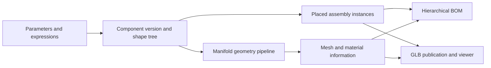
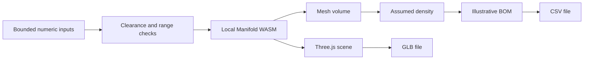

# Architecture · From definition to output

## Wider project, as inspected in source

The Vue/TypeScript frontend separates component definitions from assembly instances. The Python geometry layer evaluates shape trees and expressions, resolves references and applies transformations. PostgreSQL-backed services manage versions and model documents. This describes the inspected design and implementation structure; database-backed behaviour is not a live deployment claim.

The expression layer uses a restricted AST evaluation approach. Geometry tests inspect Boolean operations, parameter transforms, reference recursion, profiles and GLB output. The BOM service groups component/version/parameter/material signatures and handles nested quantities. Those source-level design choices are distinct from the simplified public demo.

## Public demonstration

The public demo has two explicit constructors and a circular hole pattern. Geometry is calculated with Manifold; rendering and GLB export use Three.js. It does not expose the private expression engine, plugin loader, tenant endpoints, model archives or database. Changes exist only in the current page and downloaded files.

The public GLB export converts millimetres to metres, consistent with glTF units. Flange/plate mass uses computed polygonal mesh volume. Shaft and spacer mass use analytic cylindrical volume; their rendered mesh is discretised, so those mass values are illustrative assumptions rather than exact mesh-derived quantities.

## Extension path

The private project contains a natural-language modelling contract and session/script storage services. The parser currently returns a reserved/unimplemented response. A future integration would need validated model deltas and explicit user review before application; this showcase does not simulate a working LLM.
