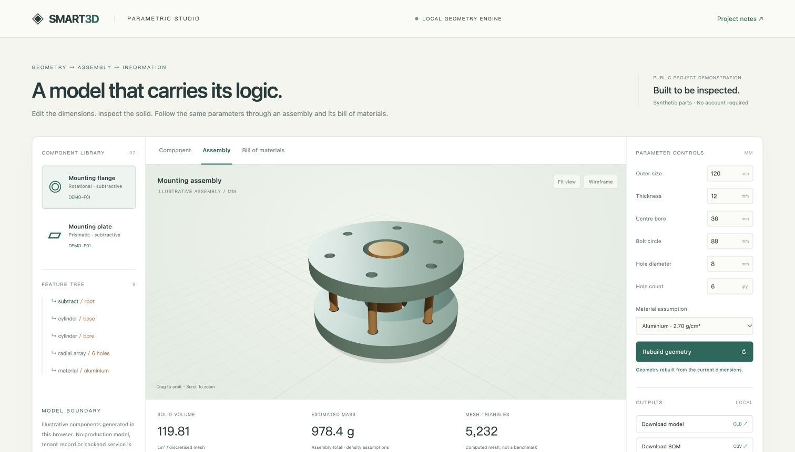
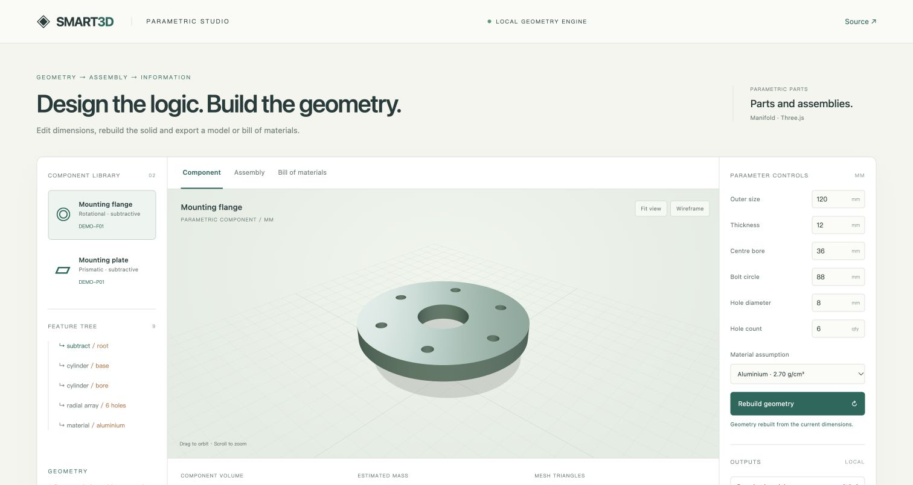

# SMART3D · Parametric Design & Assembly

### From design intent to geometry, assemblies and structured engineering data.

SMART3D presents an integrated engineering workflow in which **parameters define a part, geometry resolves its form, instances create an assembly, and the same inputs drive a bill of materials and portable model outputs**.

The result is an executable case study in computational geometry, web-based CAD and engineering information systems: inspect the model, change its dimensions, rebuild the solid and trace the consequences through the assembly.

**[Launch the interactive workbench](https://007jackiegao-cmd.github.io/smart3d-showcase/)** · [Architecture](ARCHITECTURE.md) · [Project overview](PROJECT_OVERVIEW.md) · [Validation](VALIDATION.md)



## Engineering capabilities you can inspect

| Capability | What the workbench delivers |
|---|---|
| **Parametric solid modelling** | Dimension-driven flange and plate constructors with centre bores and configurable radial hole patterns |
| **Real CSG computation** | Manifold mesh Boolean operations executed locally through WebAssembly |
| **Interactive 3D inspection** | Orbit, zoom, fit-to-view and wireframe rendering through Three.js |
| **Assembly composition** | Reusable component geometry placed into a mounting assembly with a shaft and spacer array |
| **Connected engineering information** | Quantity aggregation, computed component volume and mass estimates using explicit density assumptions |
| **Portable deliverables** | GLB models, BOM CSV and parameter JSON generated directly in the browser |

This is a working, inspectable demonstration. The figures shown in the interface are calculated from the current inputs. Screenshots depict the running application.



## Technical depth behind the workflow

The wider source project combines **Vue 3, TypeScript and Three.js** with a **FastAPI/Python geometry service, Manifold, SQLAlchemy and PostgreSQL**. Its modules cover component versions, expression-driven shape trees, geometry plugins, assembly editing, material information, hierarchical BOM processing and model publication.

The public workbench distils that architecture into a self-contained demonstration with synthetic components. It gives reviewers a direct way to examine the geometry-to-information workflow while the original backend and private runtime material remain outside the public repository.

## Evidence of computational correctness

- **75 existing computational tests passed** in an isolated copy of the source project, covering expressions, geometry, Boolean operations, profiles, export and node-level splitting.
- **12 public-demo checks passed**, covering polygonal volume references, closed mesh edges, valid coordinates, clearance guards, radial placement and BOM aggregation.
- **Browser-exported GLB and BOM files were independently checked.** The tested assembly GLB contained the expected 11 mesh instances and the intended export scale.
- **The deployed workbench was exercised** through parameter rebuilding, assembly inspection and the linked portfolio entry.

See [validation and test scope](VALIDATION.md) for reproducible checks and practical limits. These results cover the named computational and demonstration paths, rather than the complete database-backed application.

## Run locally

The repository contains the ready-to-serve application:

```sh
python3 -m http.server 8080 --bind 127.0.0.1
```

Open `http://localhost:8080` in a recent browser with WebGL and WebAssembly support. Dependencies are included locally; the demo needs no account, provider key or external data feed.

To inspect the public geometry implementation and run its checks:

```sh
npm ci --ignore-scripts
node test-demo.mjs
```

`geometry-demo.js` is the unminified demonstration kernel. `demo-source.zip` contains the full public demonstration source and build configuration.

## Scope and provenance

The public workbench and presentation were prepared with AI assistance as a focused demonstration of the project's engineering workflow. Components, identifiers and material scenarios are synthetic. Mass estimates use explicit density assumptions; they are not manufacturing or structural certification.

The wider project defines a natural-language modelling contract. Its LLM parser is reserved and is not active. Complete database-backed deployment, production security and planning-document performance targets are outside the validation claims made here.

No biography, personal contacts, credentials, tenant records, database backups or original runtime assets are included. See [publication provenance](PROVENANCE.md).

## Dependencies

- **Three.js 0.172.0** — MIT · [upstream](https://github.com/mrdoob/three.js)
- **Manifold 3.1.0** — Apache-2.0 · [upstream](https://github.com/elalish/manifold)

Bundled libraries retain their licenses and attribution. Manifold provides the mesh Boolean algorithm. No additional reuse license is granted for private source material by this showcase.
